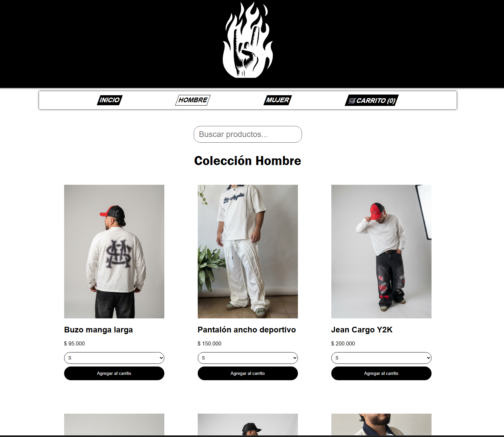

# DAVRA

DAVRA es una tienda de ropa en línea con carrito y pedidos por WhatsApp.

## LINK

https://davra-wear.netlify.app

## CAPTURA

## FUNCIONALIDADES

En DAVRA puedes buscar una prenda para encontrarla más rápido, tiene la opción de agregar al carrito por talla y finalizar el pedido por WhatsApp. Cuenta con un módulo de Administrador.

## TECNOLOGÍAS

HTML, CSS y TypeScript.

## ¿CÓMO EJECUTARLO?

Clonar el repositorio y correr "tsc".

## EXPERIENCIA

- Construí el flujo completo del carrito: agregar, quitar y guardar en el localStorage.
- Resolví un desbordamiento en celulares revisando elemento por elemento en DevTools.
- Entendí la especificidad en CSS: el `:hover` le ganaba a la clase activa.
- Arreglé un error: los celulares guardaban datos viejos sin tallas, y lo resolví con una migración.

## LO QUE HARÍA DESPUÉS

- Implementar filtro por tallas.
- Ordenar por precio, de menor a mayor y viceversa.
- Una pasarela de pagos.
- Un login de usuario.
- Tener los datos guardados en un servidor con base de datos.
